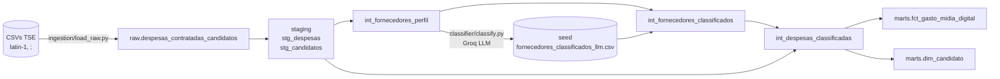

# Raio-X do gasto com mídia digital nas Eleições 2026

Quanto as campanhas de 2026 gastaram em **Meta, Google, TikTok, Kwai** e outras mídias digitais?

Na prestação de contas do TSE, o fornecedor aparece como texto livre ("FACEBOOK SERVICOS ONLINE DO BRASIL LTDA", "DLOCAL BRASIL INSTITUICAO DE PAGAMENTO", "JOYO TECNOLOGIA BRASIL"...). Este projeto cria uma camada analítica limpa, testada e documentada que classifica cada fornecedor por plataforma, usando LLM e regras, e responde a essa pergunta.

**Escopo:** despesas contratadas por candidatos, Eleições 2026, UFs **DF, SP, MG, BA, RS e AM** (712 mil lançamentos, R$ 2,44 bi).

## Principais resultados

| Plataforma | Gasto contratado | % do digital |
|---|---|---|
| Meta (Facebook/Instagram) | R$ 291,0 mi | 72,3% |
| Outras digitais (agências, produtoras, sites) | R$ 110,5 mi | 27,5% |
| Kwai | R$ 0,7 mi | 0,2% |
| Google | R$ 0,1 mi | ~0% |
| TikTok | ~R$ 0 | ~0% |

- **98% a 99% do impulsionamento foi para a Meta**, em todos os cargos.
- **Google e TikTok praticamente não aparecem**, o que é coerente com as políticas das plataformas: o Google veta anúncios políticos no Brasil desde 2024 e manteve o veto em 2026 ([Poder360](https://www.poder360.com.br/poder-eleicoes/google-veta-impulsionamento-eleitoral-nas-eleicoes-de-2026/)), e o TikTok proíbe anúncios políticos ([O Povo](https://www.opovo.com.br/noticias/politica/eleicoes/2026/08/03/tiktok-apresenta-plano-contra-a-desinformacao-nas-eleicoes.html)). Os resíduos encontrados são do tipo já apontado pela [Aos Fatos](https://www.aosfatos.org/noticias/anuncios-google-tiktok-campanha-eleitoral/).
- **NOVO é o partido mais "digital"**: 33,8% do gasto total, o dobro da média geral (16,5%). O PL lidera em valor absoluto (R$ 76 mi).
- **SP é a UF onde o digital pesa mais** (22,8% do gasto) e **BA a que menos pesa** (9,3%).

Consultas completas em [`dbt/analyses/perguntas_negocio.sql`](dbt/analyses/perguntas_negocio.sql).

## Arquitetura



| Camada | O que faz |
|---|---|
| **Ingestão** ([load_raw.py](ingestion/load_raw.py)) | Usa os CSVs locais ou baixa o zip do TSE, filtra as UFs, converte latin-1 em Parquet UTF-8 e carrega a raw com **um único load job `WRITE_TRUNCATE`**. É idempotente: rodar N vezes dá o mesmo resultado. |
| **Staging** | Tipagem, snake_case e marcadores de nulo do TSE (`#NULO`, `-1`, `-4`) convertidos em NULL. O CPF/CNPJ é normalizado (só dígitos, zeros à esquerda) e o tipo é inferido pelo tamanho, porque o TSE marca cerca de 50 mil pessoas físicas como PJ. |
| **Intermediate** | Perfil de cada fornecedor, classificação por plataforma (LLM + regras) e resolução de intermediários de pagamento pela descrição da despesa. |
| **Marts** | `fct_gasto_midia_digital` (candidato × plataforma × categoria) e `dim_candidato`. |

## Classificador de fornecedores

O desafio original sugere a Claude API. **Usei a Groq (`openai/gpt-oss-120b`) para manter o projeto com custo zero.**

Mandar os 374 mil fornecedores ao LLM seria inviável e desnecessário. A estratégia é híbrida:

| Grupo | Como é classificado | Por quê |
|---|---|---|
| PJ com sinal digital (categoria ou termo digital) | **LLM**, em lotes de 30, do maior valor para o menor | Casos ambíguos: agência ou gráfica? Plataforma ou intermediário? |
| Pessoa física | Regra: "Outras digitais" se atua em categoria digital, senão "Offline" | PF não é plataforma de anúncio, e **nenhum CPF é enviado ao LLM nem publicado** |
| Sem sinal digital | Regra: "Offline" | Militância, combustível, aluguel etc. |
| PJ ainda não processada pelo LLM | Regra de reserva por palavra-chave (confiança 0,4) | O pipeline fica completo mesmo com o LLM parcial |

**Intermediários de pagamento** (DLOCAL, EBANX) atendem várias plataformas. Para essas despesas, a plataforma vem da **descrição** quando ela cita uma ("...Facebook/Instagram (Meta) via dLocal"). Quando a descrição é genérica, vale a plataforma predominante do intermediário, identificada pelo método `fornecedor_predominante`.

O resultado do LLM fica num **seed versionado no git**. O `dbt build` não chama o LLM, então é rápido, grátis e reprodutível, e as mudanças de classificação aparecem no diff. O script é **incremental**: só classifica o que ainda não está no CSV e respeita os limites do plano gratuito, parando sem perder nada quando a cota diária acaba.

## Qualidade de dados

- **49 testes dbt**: `unique`, `not_null`, `relationships`, `accepted_values` (plataforma, cargo, UF, método), dois testes genéricos próprios (`valid_cpf_cnpj`, `confianca_entre_0_e_1`) e dois testes singulares:
  - [`assert_marts_batem_com_raw`](dbt/tests/assert_marts_batem_com_raw.sql): conciliação ponta a ponta (raw = dim_candidato, e gasto digital da dim = fct). Foi validado com um erro proposital: falha quando há duplicação.
  - [`assert_nenhum_gasto_negativo`](dbt/tests/assert_nenhum_gasto_negativo.sql).
- **Freshness** na source.
- **Documentação** em todas as colunas dos marts (`dbt docs generate`).

## Decisões e limitações

- **`SQ_DESPESA` não é único**: uma despesa pode ser rateada em várias linhas, e há cerca de 9 mil lançamentos idênticos. **Não dedupliquei**, para não subestimar o gasto declarado. A chave é `despesa_linha_id`.
- **Valor contratado, não pago**: usei o arquivo de despesas *contratadas*, como pede o desafio.
- **Uma plataforma por fornecedor**: fornecedores mistos ("impulsionamento + material gráfico") recebem uma única plataforma. Os casos encontrados são de baixo valor (R$ 15 a 20 mil cada).
- **A categoria declarada pelo candidato tem erros**: há gráficas lançadas como "impulsionamento". O LLM prioriza nome, CNAE e descrição.
- **A confiança do LLM é autodeclarada** e otimista (média de 0,92 a 0,96). O fato expõe `vr_gasto_classificado_llm` para separar o que veio do LLM do que veio de regra.
- **Cobertura do LLM**: na data deste README, 1.140 fornecedores, ou **96% do valor** dos fornecedores PJ com sinal digital. O restante usa a regra de reserva até o script terminar, já que a cota gratuita classifica cerca de 1.100 fornecedores por dia.
- **BigQuery Sandbox**: as tabelas expiram em 60 dias e o DML é restrito. Por isso a ingestão usa load job, e não `DELETE`/`MERGE`.

## Como rodar

**Pré-requisitos:** Python 3.11+, um projeto no Google Cloud com BigQuery Sandbox, uma service account (BigQuery Data Editor + Job User) com chave JSON e uma chave gratuita da [Groq](https://console.groq.com).

```bash
# 1. Ambiente
python -m venv .venv
.venv\Scripts\activate            # Linux/Mac: source .venv/bin/activate
pip install -r requirements.txt

# 2. Configuração
cp .env.example .env              # preencha GCP_PROJECT_ID e GROQ_API_KEY
# salve a chave da service account em credentials/gcp-key.json
python ingestion/check_setup.py   # deve imprimir "BigQuery OK" e "Groq OK"

# 3. Ingestão (baixa ~400 MB do TSE se os CSVs não estiverem em data/)
python ingestion/load_raw.py

# 4. Transformações + testes
cd dbt
dbt build                         # seed + modelos + 49 testes

# 5. (Opcional) Reclassificar / continuar a classificação com LLM
cd ..
python classifier/classify.py     # incremental, respeita a cota gratuita
cd dbt && dbt build

# 6. Documentação
dbt docs generate && dbt docs serve
```

## Estrutura

```
├── ingestion/
│   ├── check_setup.py          # valida credenciais
│   └── load_raw.py             # TSE -> BigQuery raw (idempotente)
├── classifier/
│   └── classify.py             # classificação de fornecedores com LLM (Groq)
├── dbt/
│   ├── models/
│   │   ├── staging/            # sources, stg_despesas, stg_candidatos
│   │   ├── intermediate/       # perfil e classificação de fornecedores/despesas
│   │   └── marts/              # fct_gasto_midia_digital, dim_candidato
│   ├── seeds/                  # fornecedores_classificados_llm.csv
│   ├── macros/                 # tratamento de nulos/formatos do TSE, regex de plataforma
│   ├── tests/                  # testes singulares e genéricos
│   └── analyses/               # perguntas_negocio.sql
└── requirements.txt
```

## Stack

Python · BigQuery (Sandbox) · dbt-core + dbt-bigquery · Groq (gpt-oss-120b) · Git/GitHub

**Fonte dos dados:** [Portal de Dados Abertos do TSE](https://dadosabertos.tse.jus.br/), Prestação de Contas Eleitorais 2026.
